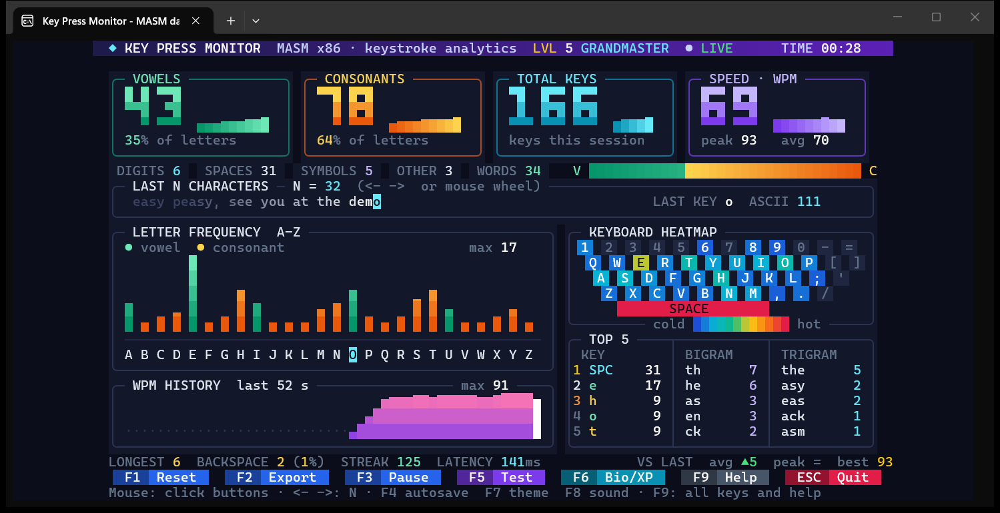
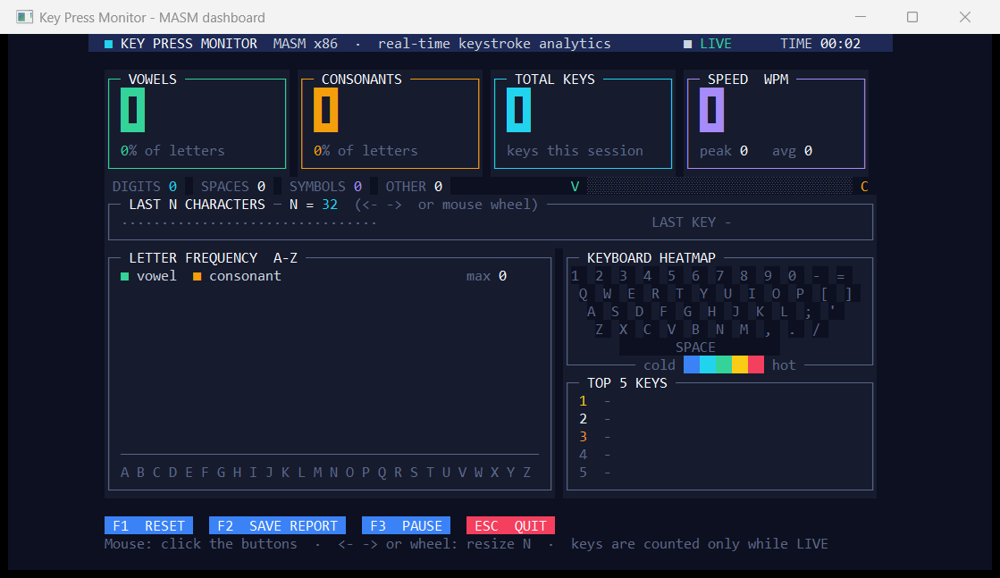
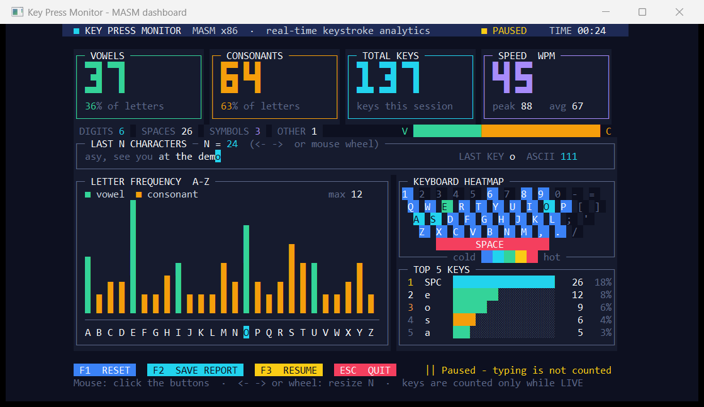

<div align="center">

# ⌨️ KeyPressMonitor

**A real-time keyboard analytics dashboard written entirely in 32-bit MASM assembly.**




</div>

Type anywhere in the console and watch live statistics: vowels vs. consonants, a per-key frequency histogram, a keyboard heatmap, typing speed (WPM) and a rolling view of the last N characters. No Irvine32, no MASM32 SDK: just `kernel32.lib`.

## Table of contents

- [Features](#features) · [Controls](#controls) · [Quick start](#quick-start) · [Sample report](#sample-report) · [How it works](#how-it-works-short) · [Project layout](#project-layout) · [Troubleshooting](#troubleshooting) · [License](#license)
## Features

**Required**

1. Counts **vowels and consonants** (big cards at the top, plus a vowel/consonant mix bar)
2. **Frequency of every key** (A-Z histogram, top-5 table, and the full table in the report)
3. Shows the **last N characters** typed (circular buffer; the newest key is highlighted)

**Extra**

| Feature | How it's done in MASM |
|---------|-----------------------|
| Flicker-free colour dashboard | Everything is drawn into a 100x30 `CHAR_INFO` array, then copied with one `WriteConsoleOutputA` call |
| Custom colour theme | `SetConsoleScreenBufferInfoEx` replaces the 16 console colours; the original colours are restored on exit |
| Big block-digit numbers | A 3x3 font made of CP437 block characters (`bigFont`) |
| A-Z letter histogram | Bars use full and half blocks for double vertical resolution; vowels green, consonants amber |
| Keyboard heatmap | QWERTY keys coloured cold to hot by how often each virtual key was pressed |
| Typing speed | Live WPM (keys in the last 5 s), peak WPM, average WPM and a session timer via `GetTickCount` |
| Top 5 keys | Selection over the 256-entry frequency table, with bars and percentages |
| Word counter | A run of letters/digits counts as one word; shown as a WORDS chip and in the report |
| More categories | Separate counters for digits, spaces, symbols and other keys (Enter, Tab, Backspace...) |
| Mouse buttons | `ReadConsoleInputA` mouse events: click Reset / Save / Pause / Quit, buttons highlight on hover |
| Adjustable N | Left/Right arrows or the mouse wheel change N from 8 to 64 |
| Pause | F3 stops counting (shown in the header and the button bar) |
| Save report | F2 writes `KeyReport.txt` with `CreateFileA` / `WriteFile`; the same report is printed on exit |

## Controls

| Key | Action |
|-----|--------|
| F1 | Reset all counters |
| F2 | Save report to `KeyReport.txt` |
| F3 | Pause / resume counting |
| Left / Right, mouse wheel | Change N |
| ESC | Quit and print the final report |

All buttons can also be clicked with the mouse.

| Start | Paused, N = 24 |
|-------|----------------|
|  |  |

---

## Quick start

### 1. Install the tools (one time only)

1. Download **Visual Studio Community** (free): https://visualstudio.microsoft.com/
2. In the installer, tick **"Desktop development with C++"** and install.
   This gives you `ml.exe` (MASM) and `link.exe`.

### 2. Get the code

```bat
git clone https://github.com/Aricode2005/KeyPressMonitor.git
cd KeyPressMonitor
```

### 3. Build

1. Open the Start menu and search for **"x86 Native Tools Command Prompt for VS"**.
   > It must be **x86** (32-bit), not x64.
2. `cd` into the `KeyPressMonitor` folder.
3. Run:

```bat
build.bat
```

Or build by hand:

```bat
ml /c /coff KeyMonitor.asm
link /subsystem:console KeyMonitor.obj kernel32.lib
```

### 4. Run

```bat
KeyMonitor.exe
```

The dashboard needs a console of at least 100 x 30 characters (the default Windows console is 120 x 30).
If the colours look wrong in Windows Terminal, run it in the classic console instead: `conhost KeyMonitor.exe`.

## Sample report

Printed when you press ESC, and saved to `KeyReport.txt` with F2:

```
========== KEY PRESS MONITOR - REPORT ==========
Total keys       : 137
Total Vowels     : 37
Total Consonants : 64
Digits           : 6
Spaces           : 26
Symbols          : 3
Other keys       : 1
Peak WPM         : 88
Average WPM      : 70
Session time     : 00:23
Last N chars     : [ easy peasy, see you at the demo]

Top 5 keys:
  1.  SPC   x 26
  2.  e     x 12
  3.  o     x 9
  4.  s     x 6
  5.  a     x 5

Key Frequency:
  e    (ASCII 101)  ->  12
  ...
```

## How it works (short)

| Part | What it does |
|------|--------------|
| `SetConsoleMode(hIn, 98h)` | Raw input with mouse events on (QuickEdit off), so keys and clicks arrive instantly |
| `WaitForSingleObject` + `ReadConsoleInputA` | Waits up to 250 ms for input, so the screen keeps updating (timer, WPM) even when idle |
| `freq` (256 DWORDs) | `freq[ascii]++` for every key |
| `vkFreq` (256 DWORDs) | Count per virtual key, used by the keyboard heatmap |
| `lastRing` (64 bytes) | Circular buffer of the last N keys; the index wraps with `AND 63` |
| `tsRing` (128 DWORDs) | Time of each recent key press, used for WPM |
| Vowel check | Converts letter to lowercase, compares with `"aeiou"` |
| `canvas` | 100 x 30 cells drawn every frame, then copied to the screen in one call |

To change the default N, edit 
View DD 32` in `KeyMonitor.asm` (8 to 64).

## Troubleshooting

- **`'ml' is not recognized`** – you're not in the *x86 Native Tools Command Prompt*.
- **`cannot open file 'kernel32.lib'`** – same reason; use the x86 Native Tools prompt.
- **Dashboard is cut off** – make the console window at least 100 x 30, or maximise it.
- Arrow / function keys don't produce characters, so they are not counted (they're used as controls).

## Project layout

```
KeyPressMonitor/
├── KeyMonitor.asm     # the whole program
├── build.bat          # one-step build (x86 Native Tools prompt)
├── screenshots/       # images used in this README
├── .github/workflows/ # CI: builds the project on every push
├── CONTRIBUTING.md
└── LICENSE
```

## License

Released under the [MIT License](LICENSE).
